<a id="readme-top"></a>


<br />
<div align="center">
  <h3 align="center">Juris Bridge MCP</h3>

  <p align="center">
    A remote, extensible and testable MCP server that gives AI agents access to Brazilian judicial data through a unified interface. Bridging AI Agents with Brazil's judicial ecosystem.
    <br />
    <a href="CONTRIBUTING.md"><strong>Explore the docs »</strong></a>
    <br />
    <br />
    <a href="https://github.com/emvalencaf/juris-bridge-mcp/issues/new">Report Bug</a>
    &middot;
    <a href="https://github.com/emvalencaf/juris-bridge-mcp/issues/new">Request Feature</a>
  </p>
</div>

<details>
  <summary>Table of Contents</summary>
  <ol>
    <li>
      <a href="#about-the-project">About The Project</a>
      <ul>
        <li><a href="#built-with">Built With</a></li>
      </ul>
    </li>
    <li>
      <a href="#getting-started">Getting Started</a>
      <ul>
        <li><a href="#prerequisites">Prerequisites</a></li>
        <li><a href="#installation">Installation</a></li>
        <li><a href="#quick-start">Quick start</a></li>
      </ul>
    </li>
    <li><a href="#usage">Usage</a></li>
    <li><a href="#roadmap">Roadmap</a></li>
    <li><a href="#contributing">Contributing</a></li>
    <li><a href="#license">License</a></li>
    <li><a href="#contact">Contact</a></li>
    <li><a href="#acknowledgments">Acknowledgments</a></li>
  </ol>
</details>

## About The Project

A remote, extensible and testable MCP server that gives AI agents access to Brazilian judicial data through a unified interface. Bridging AI Agents with Brazil's judicial ecosystem.

It exposes five read-only tools over two Sources, and every result is a Normalized result with its Source, a Citation and a Content kind:

| Tool | What it does |
|---|---|
| `search_cases` | Search Cases of a Court by class, judging body, subject and filing dates (DataJud, metadata only) |
| `get_case` | Fetch one Case by its CNJ number; the Court is derived from the number |
| `search_legislation` | Find a Norm by type, number and year (Senado) |
| `get_legislation` | Fetch a Norm by URN Lex, with its text from the Planalto or, as a fallback, Câmara Legin |
| `list_coverage` | State what the server can and cannot answer, by Source and Court |

Terms such as Case, Court, Source and Citation are defined in [GLOSSARY.md](GLOSSARY.md).

### How it fits together



Every request passes the same path: Bearer auth, one wide event per request, the tool, its use case and the Source.



<p align="right">(<a href="#readme-top">back to top</a>)</p>

### Built With

* [Python](https://www.python.org) managed with [uv](https://docs.astral.sh/uv/)
* [ruff](https://docs.astral.sh/ruff/)

<p align="right">(<a href="#readme-top">back to top</a>)</p>

## Getting Started

### Prerequisites

* [`uv`](https://docs.astral.sh/uv/) (Python 3.12 or newer), or Docker
* A DataJud public key, which the CNJ publishes and may change at any time: see the [DataJud wiki](https://datajud-wiki.cnj.jus.br/api-publica/). Each user runs their own instance with their own key (see [RESPONSIBLE_USE.md](RESPONSIBLE_USE.md)).

### Installation

1. Clone the repository
   ```bash
   git clone https://github.com/emvalencaf/juris-bridge-mcp.git
   cd juris-bridge-mcp
   ```
2. Install the dependencies and enable the git hooks (contributors)
   ```bash
   uv sync
   scripts/setup.sh
   ```

### Quick start

1. Copy `.env.example` to `.env` and set `JURIS_BRIDGE_SERVER_API_KEYS` (the Bearer key your client will send; the server refuses to start without one) and `JURIS_BRIDGE_DATAJUD_API_KEY` (the DataJud public key).
2. Start the server
   ```bash
   # uv
   set -a; source .env; set +a
   uv run python -m juris_bridge_mcp.main

   # or container
   docker build -t juris-bridge-mcp .
   docker run --rm -p 8000:8000 --env-file .env juris-bridge-mcp
   ```
   The MCP endpoint is `http://localhost:8000/mcp`.
3. Point your MCP client at it. For a client that takes a JSON configuration:
   ```json
   {
     "mcpServers": {
       "juris-bridge": {
         "type": "http",
         "url": "http://localhost:8000/mcp",
         "headers": { "Authorization": "Bearer <your JURIS_BRIDGE_SERVER_API_KEYS value>" }
       }
     }
   }
   ```
   With Claude Code: `claude mcp add --transport http juris-bridge http://localhost:8000/mcp --header "Authorization: Bearer <key>"`.
4. Ask for a Norm, for example "get Lei 14.133/2021 and quote Art. 1", to check the whole chain.

<p align="right">(<a href="#readme-top">back to top</a>)</p>

## Usage

### Running the server

The same image runs everywhere; it only reads environment variables (see `.env.example`).

```bash
# uv
JURIS_BRIDGE_SERVER_API_KEYS=my-key JURIS_BRIDGE_DATAJUD_API_KEY=... uv run python -m juris_bridge_mcp.main

# container (MCP endpoint: http://localhost:8000/mcp, Authorization: Bearer my-key)
docker build -t juris-bridge-mcp .
docker run --rm -p 8000:8000 --env-file .env juris-bridge-mcp
```

The AWS Reference deployment (Lambda + Function URL, Terraform) lives in
[`deploy/aws/`](deploy/aws/README.md); run `deploy/aws/deploy.sh`. See the
[AWS Reference deployment diagram](docs/diagrams/assets/04-aws-deployment.svg).

### Getting a Norm and its text

`get_legislation` takes the metadata from the Senado and, on request, the text from the
Planalto, then Câmara Legin, then metadata and links only. `content_kind` and `warnings` say
which one supplied it.



### Known limits

The rate limit and cache are explained further in [docs/known-limits.md](docs/known-limits.md).

- The rate limiter is **per instance**: each warm environment counts on its own, so
  several instances can together exceed a Source's limit (DataJud: 120 req/min).
- The in-memory cache is **per warm environment**: it is lost on cold start and
  not shared between instances.
- The `revoked` and `superseded` flags of a norm article rest on the Planalto markup (a
  `(Revogado ...)` note, or a struck-through opening line). Older pages mark them
  inconsistently, so a revoked article can be missed or a current one flagged.
- An article runs to the next article or heading. A rubric the parser does not recognise as a
  title can still trail an article in older norms.
- Planalto page paths are built by convention, as there is no index by URN. Norms without a
  convention (a `mensagem`, old provisional measures) and some pre-2004 layouts return metadata
  and a warning, not the text, unless Câmara Legin has them.
- When the Planalto has no page or refuses, the text comes from Câmara Legin, whose URL is not
  derivable from the URN and is read off the LexML URN page and the Câmara data sheet. If the
  LexML portal serves its security challenge, the server does not solve it and the call is
  `source_blocked`. The Legin text carries few Annotations, its `warnings` give the amending
  norms from the data sheet as hints only, and a very large consolidated page (e.g. Lei
  14.133) may time out at the Câmara (`source_unavailable`, retryable).


<p align="right">(<a href="#readme-top">back to top</a>)</p>

## Roadmap

- [x] Five read-only tools over DataJud and the Senado, with Planalto and Câmara Legin text
- [x] Container and AWS Reference deployment
- [ ] Docs, responsible use and diagrams (in progress, #32)
- [ ] Case law text and more Courts (see the open issues)

See the [open issues](https://github.com/emvalencaf/juris-bridge-mcp/issues) for proposed features and known issues.

<p align="right">(<a href="#readme-top">back to top</a>)</p>

## Contributing

Contributions follow the branch strategy and commit convention in
[CONTRIBUTING.md](CONTRIBUTING.md): cut a branch from `development`, commit as
`tag(subject/subsubject): summary`, and open a pull request into `development`.
Coding and documentation rules are in [CODE_STANDARDS.md](CODE_STANDARDS.md).

<p align="right">(<a href="#readme-top">back to top</a>)</p>

## License

Distributed under the Apache-2.0 licence. See [LICENSE](LICENSE).

**Responsible use.** The code is Apache-2.0, but the data is not. DataJud's terms allow only lawful, non-commercial use and forbid redistributing information derived from it, so run your own instance with your own DataJud key and keep the results for your own use. A shared instance needs written CNJ authorization. The server returns Case metadata only, has no party, judge or CPF search, and never logs search text, CNJ numbers or payloads. Read [RESPONSIBLE_USE.md](RESPONSIBLE_USE.md) before you deploy it.

<p align="right">(<a href="#readme-top">back to top</a>)</p>

## Contact

Edson Mota Valença Filho - [@emvalencaf](https://github.com/emvalencaf)

Project Link: [https://github.com/emvalencaf/juris-bridge-mcp](https://github.com/emvalencaf/juris-bridge-mcp)

<p align="right">(<a href="#readme-top">back to top</a>)</p>

## Acknowledgments

* [Best-README-Template](https://github.com/othneildrew/Best-README-Template)

<p align="right">(<a href="#readme-top">back to top</a>)</p>
