<a id="readme-top"></a>

[](README.md)
[](README.pt-BR.md)

<br />
<div align="center">
  <h3 align="center">Juris Bridge MCP</h3>

  <p align="center">
    Um servidor MCP remoto, extensível e testável que dá a agentes de IA acesso a dados judiciais brasileiros por uma interface unificada. Uma ponte entre agentes de IA e o ecossistema judicial do Brasil.
    <br />
    <a href="docs/known-limits.md"><strong>Explore a documentação »</strong></a>
    <br />
    <br />
    <a href="https://github.com/emvalencaf/juris-bridge-mcp/issues/new">Reportar um bug</a>
    &middot;
    <a href="https://github.com/emvalencaf/juris-bridge-mcp/issues/new">Pedir uma funcionalidade</a>
  </p>
</div>

> Esta é a tradução em português do [README original](README.md). Em caso de divergência, vale o original em inglês.

<details>
  <summary>Sumário</summary>
  <ol>
    <li>
      <a href="#sobre-o-projeto">Sobre o projeto</a>
      <ul>
        <li><a href="#construído-com">Construído com</a></li>
      </ul>
    </li>
    <li>
      <a href="#primeiros-passos">Primeiros passos</a>
      <ul>
        <li><a href="#requisitos">Requisitos</a></li>
        <li><a href="#instalação">Instalação</a></li>
        <li><a href="#início-rápido">Início rápido</a></li>
      </ul>
    </li>
    <li>
      <a href="#uso">Uso</a>
      <ul>
        <li><a href="#executando-o-servidor">Executando o servidor</a></li>
        <li><a href="#obtendo-uma-norma-e-o-seu-texto">Obtendo uma Norma e o seu texto</a></li>
        <li><a href="#buscando-publicações">Buscando Publicações</a></li>
        <li><a href="#cobertura">Cobertura</a></li>
        <li><a href="#limites-conhecidos">Limites conhecidos</a></li>
      </ul>
    </li>
    <li><a href="#roteiro">Roteiro</a></li>
    <li><a href="#contribuindo">Contribuindo</a></li>
    <li><a href="#licença">Licença</a></li>
    <li><a href="#contato">Contato</a></li>
    <li><a href="#agradecimentos">Agradecimentos</a></li>
  </ol>
</details>

## Sobre o projeto

Um servidor MCP remoto, extensível e testável que dá a agentes de IA acesso a dados judiciais brasileiros por uma interface unificada. Uma ponte entre agentes de IA e o ecossistema judicial do Brasil.

Ele expõe sete ferramentas somente de leitura sobre três Fontes (Sources), e todo resultado é um resultado normalizado (Normalized result) com a sua Fonte, uma Citação (Citation) e um tipo de conteúdo (Content kind):

| Ferramenta | O que faz |
|---|---|
| `search_cases` | Busca Processos (Cases) de um Tribunal (Court) por classe, órgão julgador, assunto e datas de ajuizamento (DataJud, só metadados) |
| `get_case` | Busca um Processo pelo número CNJ; o Tribunal é derivado do número |
| `search_publications` | Busca as Publicações (Publications) de um Tribunal divulgadas numa janela de até 31 dias, do dia mais recente ao mais antigo, com cursor e `complete`/`incomplete_reason` (DJEN, metadados e um trecho em texto simples, classificadas por `kind`, com despachos e avisos descartados; nomes de partes são dados pessoais pela LGPD) |
| `get_publication` | Lê o texto simples completo de uma Publicação pelo `id` que uma busca devolveu, em fatias encadeadas por um cursor (DJEN, `full_text`) |
| `search_legislation` | Encontra uma Norma por tipo, número e ano (Senado) |
| `get_legislation` | Busca uma Norma por URN Lex, com o texto do Planalto ou, como alternativa, da Câmara Legin |
| `list_coverage` | Informa o que o servidor pode e não pode responder, por Fonte e Tribunal |

Termos como Processo (Case), Tribunal (Court), Fonte (Source) e Citação (Citation) estão definidos no [GLOSSARY.md](GLOSSARY.md), em inglês. Neste texto, os nomes dos termos do glossário aparecem em inglês entre parênteses na primeira ocorrência.

### Como as peças se encaixam



Toda requisição segue o mesmo caminho: autenticação Bearer, um evento amplo (wide event) por requisição, a ferramenta, o seu caso de uso e a Fonte.



<p align="right">(<a href="#readme-top">voltar ao topo</a>)</p>

### Construído com

* [Python](https://www.python.org) gerenciado com [uv](https://docs.astral.sh/uv/)
* [FastMCP](https://gofastmcp.com) para o servidor MCP ([ADR 0001](docs/adr/0001-vertical-slices-on-fastmcp.md))
* [ruff](https://docs.astral.sh/ruff/)
* [Terraform](https://www.terraform.io) e AWS Lambda para o deploy de referência (Reference deployment)

<p align="right">(<a href="#readme-top">voltar ao topo</a>)</p>

## Primeiros passos

### Requisitos

* [`uv`](https://docs.astral.sh/uv/) (Python 3.12 ou mais novo), ou Docker
* Uma chave pública do DataJud, que o CNJ publica e pode mudar a qualquer momento: veja a [wiki do DataJud](https://datajud-wiki.cnj.jus.br/api-publica/). Cada pessoa roda a sua própria instância com a sua própria chave (veja [RESPONSIBLE_USE.md](RESPONSIBLE_USE.md)).

### Instalação

1. Clone o repositório
   ```bash
   git clone https://github.com/emvalencaf/juris-bridge-mcp.git
   cd juris-bridge-mcp
   ```
2. Instale as dependências e ative os hooks do git (para quem contribui)
   ```bash
   uv sync
   scripts/setup.sh
   ```

### Início rápido

1. Copie `.env.example` para `.env` e defina `JURIS_BRIDGE_SERVER_API_KEYS` (a chave Bearer que o seu cliente vai enviar; o servidor se recusa a iniciar sem uma) e `JURIS_BRIDGE_DATAJUD_API_KEY` (a chave pública do DataJud).
2. Inicie o servidor (com `uv` ou como contêiner; veja [Executando o servidor](#executando-o-servidor))
   ```bash
   set -a; source .env; set +a
   uv run python -m juris_bridge_mcp.main
   ```
   O endpoint MCP é `http://localhost:8000/mcp`.
3. Aponte o seu cliente MCP para ele. Para um cliente que aceita configuração em JSON:
   ```json
   {
     "mcpServers": {
       "juris-bridge": {
         "type": "http",
         "url": "http://localhost:8000/mcp",
         "headers": { "Authorization": "Bearer <o valor de JURIS_BRIDGE_SERVER_API_KEYS>" }
       }
     }
   }
   ```
   Com o Claude Code: `claude mcp add --transport http juris-bridge http://localhost:8000/mcp --header "Authorization: Bearer <chave>"`.
4. Verifique a cadeia: peça uma Norma, por exemplo "busque a Lei 14.133/2021 e cite o Art. 1" (Senado e Planalto), e depois um Processo, por exemplo "busque o Processo 0000000-00.0000.0.00.0000" com um número CNJ real (DataJud, que exige `JURIS_BRIDGE_DATAJUD_API_KEY`). O `list_coverage` responde sem chamada de rede, então mostra apenas que o servidor está acessível e que a chave Bearer foi aceita.

<p align="right">(<a href="#readme-top">voltar ao topo</a>)</p>

## Uso

### Executando o servidor

A mesma imagem roda em qualquer lugar; ela só lê variáveis de ambiente (veja `.env.example`).

```bash
# uv
JURIS_BRIDGE_SERVER_API_KEYS=minha-chave JURIS_BRIDGE_DATAJUD_API_KEY=... uv run python -m juris_bridge_mcp.main

# contêiner (endpoint MCP: http://localhost:8000/mcp, Authorization: Bearer minha-chave)
docker build -t juris-bridge-mcp .
docker run --rm -p 8000:8000 --env-file .env juris-bridge-mcp
```

O deploy de referência na AWS (Lambda + Function URL, Terraform) fica em
[`deploy/aws/`](deploy/aws/README.md); rode `deploy/aws/deploy.sh`. Veja o
[diagrama do deploy de referência na AWS](docs/diagrams/assets/04-aws-deployment.svg).

### Obtendo uma Norma e o seu texto

O `get_legislation` pega os metadados do Senado e, sob pedido, o texto do Planalto, depois da
Câmara Legin, e por último só metadados e links. `content_kind` e `warnings` dizem qual deles
forneceu o texto.



### Buscando Publicações

O `search_publications` interpreta o `query` por conta própria, já que o DJEN recebe o texto
como uma frase ordenada e adjacente e não tem operadores:

| Escreva | Significado |
|---|---|
| `recurso especial` | as duas palavras (um espaço é AND) |
| `"dano moral"` | as palavras juntas e na ordem |
| `dano OR consumidor` | qualquer um dos grupos, até 3 grupos; os resultados são unidos sem duplicatas |
| `-honorários` ou `-"erro médico"` | exclui, até 8 no total |

Cada grupo pede ao DJEN a sua frase mais longa ou, na falta dela, a sua palavra mais longa (com
pelo menos 5 caracteres); o resto do grupo filtra o texto aqui, ignorando maiúsculas e acentos e
casando por prefixo de palavra (`recurso` encontra `recursos`; não há stemming). A palavra pedida
ao DJEN é casada por ele de forma exata, então acrescente um grupo OR para outra forma dela.

Com `cnj_number` (formatado ou com 20 dígitos), a busca lista as Publicações daquele Processo: o
tribunal é derivado do número (ou conferido com `court`), o `query` é opcional e filtra só
aqui, sem tamanho mínimo de termo. Para o Processo em si, chame `get_case`.

A janela é lida um dia por vez, do mais recente ao mais antigo, com no máximo 10 requisições
ao DJEN por chamada. `complete` é verdadeiro quando a busca chegou ao fim da janela; caso
contrário, `incomplete_reason` diz o motivo: `budget` (há mais resultados; passe `next_cursor`
de volta como `cursor`), `slice_cap` ou `depth_ceiling` (o DJEN para de contar em 10.000
resultados de um dia e de paginar depois de cerca de 10.000 de uma fatia, então restrinja a
consulta). Um dia que atinge o teto de contagem é dividido por órgão emissor (Issuing body),
usando o catálogo que acompanha o servidor ([ADR 0007](docs/adr/0007-issuing-body-catalog-from-a-maintainer-script.md)).



### Cobertura

O `list_coverage` informa, por Fonte e Tribunal, o que pode ser respondido, sem chamada de rede.

| Fonte | Tipo | Coberto | Não coberto |
|---|---|---|---|
| DataJud | Processos | 91 Tribunais por alias (`tjsp`, `trf1`, `tre-sp`...) | STF |
| DJEN | Publicações | todo Tribunal do DataJud, menos os TREs; `available_from` dá o primeiro dia com dados conhecido | STF e os TREs: `not_covered`, sem alternativa em portais |
| Senado | Legislação | normas federais | |

O DJEN não é um arquivo: ele guarda Publicações de cerca de 2021 em diante, e de mais tarde para
muitos Tribunais (TJSP a partir de 2025-03, STJ a partir de 2024-12), e um Tribunal sem
`available_from` não tem início conhecido. Uma janela que termina antes do início de um Tribunal
é `not_covered`. Os resultados podem não ser exaustivos.

### Limites conhecidos

O limite de taxa e o cache são explicados melhor em [docs/known-limits.md](docs/known-limits.md).

- O limitador de taxa é **por instância**: cada ambiente ativo conta por conta própria, então
  várias instâncias juntas podem exceder o limite de uma Fonte (DataJud: 120 req/min).
- O cache em memória é **por ambiente ativo**: ele se perde numa partida a frio e não é
  compartilhado entre instâncias.
- Um dia do DJEN no teto de 10.000 itens é dividido por órgão emissor a partir de um catálogo que
  acompanha o servidor. Um órgão ausente do catálogo e da primeira página do dia passa
  despercebido; veja [docs/known-limits.md](docs/known-limits.md). A manutenção atualiza o
  catálogo com `scripts/build_issuing_body_catalog.py`.
- Os indicadores `revoked` e `superseded` de um artigo de norma se apoiam na marcação do
  Planalto (uma nota `(Revogado ...)` ou uma linha de abertura tachada). Páginas mais antigas
  marcam isso de forma inconsistente, então um artigo revogado pode passar batido ou um vigente
  pode ser sinalizado.
- Um artigo vai até o próximo artigo ou título. Uma rubrica que o analisador não reconhece como
  título ainda pode ficar no fim de um artigo em normas mais antigas.
- Os caminhos das páginas do Planalto são montados por convenção, pois não há índice por URN.
  Normas sem convenção (uma `mensagem`, medidas provisórias antigas) e alguns formatos
  anteriores a 2004 devolvem metadados e um aviso, e não o texto, a menos que a Câmara Legin os
  tenha.
- Quando o Planalto não tem a página ou a recusa, o texto vem da Câmara Legin, cuja URL não se
  deriva da URN e é lida na página de URN do LexML e na ficha de dados da Câmara. Se o portal
  LexML apresentar o seu desafio de segurança, o servidor não o resolve e a chamada é
  `source_blocked`. O texto da Legin traz poucas Anotações (Annotations), os seus `warnings`
  apontam as normas modificadoras da ficha de dados apenas como pistas, e uma página consolidada
  muito grande (por exemplo, a Lei 14.133) pode expirar na Câmara (`source_unavailable`, com nova
  tentativa possível).


<p align="right">(<a href="#readme-top">voltar ao topo</a>)</p>

## Roteiro

- [x] Sete ferramentas somente de leitura sobre DataJud, DJEN e Senado, com texto do Planalto e da Câmara Legin
- [x] Contêiner e deploy de referência na AWS
- [x] Documentação, uso responsável e diagramas (#32)
- [ ] Catálogo de órgãos emissores para os demais Tribunais do DJEN (#84)
- [ ] Texto de jurisprudência e mais Tribunais (veja as issues abertas)

Veja as [issues abertas](https://github.com/emvalencaf/juris-bridge-mcp/issues) para funcionalidades propostas e problemas conhecidos.

<p align="right">(<a href="#readme-top">voltar ao topo</a>)</p>

## Contribuindo

As contribuições seguem a estratégia de branches e a convenção de commits do
[CONTRIBUTING.md](CONTRIBUTING.md): crie uma branch a partir de `development`, faça commits no
formato `tag(assunto/subassunto): resumo` e abra um pull request para `development`.
As regras de código e de documentação estão no [CODE_STANDARDS.md](CODE_STANDARDS.md).

<p align="right">(<a href="#readme-top">voltar ao topo</a>)</p>

## Licença

Distribuído sob a licença Apache-2.0. Veja [LICENSE](LICENSE).

**Uso responsável.** O código é Apache-2.0, mas os dados não são. Os termos do DataJud permitem apenas o uso lícito e não comercial e proíbem redistribuir informações derivadas dele, então rode a sua própria instância com a sua própria chave do DataJud e mantenha os resultados para o seu uso. Uma instância compartilhada exige autorização escrita do CNJ. Para Processos, o servidor devolve apenas metadados do DataJud, não tem busca por parte, juiz ou CPF e nunca registra em log o texto da busca, números CNJ ou payloads. As Publicações trazem nomes de partes, que são dados pessoais pela LGPD. Leia o [RESPONSIBLE_USE.md](RESPONSIBLE_USE.md) antes de implantá-lo.

<p align="right">(<a href="#readme-top">voltar ao topo</a>)</p>

## Contato

Edson Mota Valença Filho - [@emvalencaf](https://github.com/emvalencaf)

Link do projeto: [https://github.com/emvalencaf/juris-bridge-mcp](https://github.com/emvalencaf/juris-bridge-mcp)

<p align="right">(<a href="#readme-top">voltar ao topo</a>)</p>

## Agradecimentos

* [Best-README-Template](https://github.com/othneildrew/Best-README-Template)

<p align="right">(<a href="#readme-top">voltar ao topo</a>)</p>
